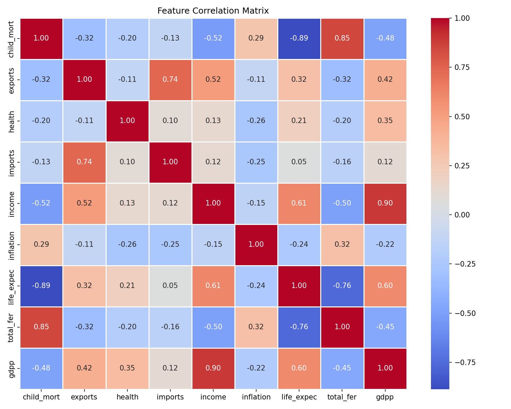
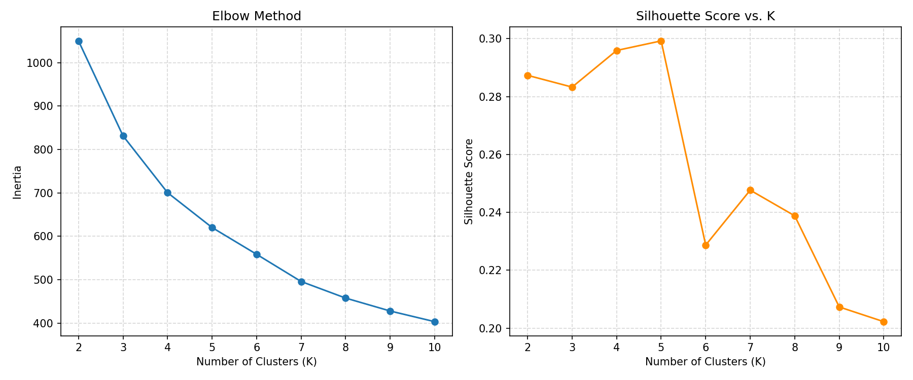
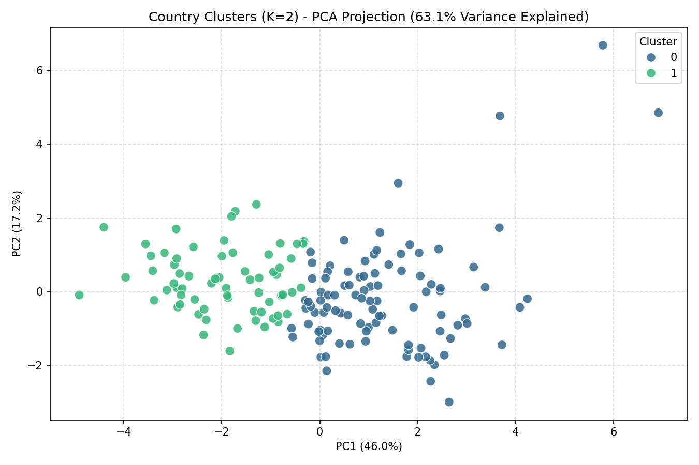

# Country Clustering using K-Means

This project applies the K-Means clustering algorithm to group countries based on numerical socio-economic and health indicators extracted from a CSV dataset. The workflow covers exploratory data analysis (EDA), preprocessing, unsupervised clustering, and cluster evaluation to uncover patterns and similarities between countries.

## Problem Statement
The goal of this project is to cluster countries into distinct groups based on their development indicators and analyze whether meaningful, interpretable groupings emerge from the data.

## Dataset
The dataset (`Country-data.csv`, sourced from Kaggle / HELP International) contains **167 countries** and **9 numerical features**:

- `child_mort`: Death of children under 5 years of age per 1,000 live births
- `exports`: Exports of goods and services per capita (% of GDP per capita)
- `health`: Total health spending per capita (% of GDP per capita)
- `imports`: Imports of goods and services per capita (% of GDP per capita)
- `income`: Net income per person
- `inflation`: Annual growth rate of total GDP
- `life_expec`: Average life expectancy of a newborn
- `total_fer`: Number of children born to each woman
- `gdpp`: GDP per capita

## Approach
1. **Exploratory Data Analysis (EDA):** Inspected summary statistics, missing values, feature distributions, and correlations.
2. **Preprocessing:** Selected numerical features and applied `StandardScaler` so all indicators contribute equally to Euclidean distance calculations.
3. **Model Selection:** Evaluated multiple values of $K$ ($K = 2 \dots 10$) using the Elbow Method and Silhouette Score.
4. **Clustering & Visualization:** Applied K-Means with $K = 2$ on standardized features and projected the clusters into 2D using PCA for visualization.

## Visual Results

### Correlation Matrix


### Choosing K (Elbow Method & Silhouette Score)


### Cluster Visualization (K = 2)


## Results
- **$K = 2$** achieved a **Silhouette Score of `0.2874`**, producing the most interpretable split across the 167 countries:
  - **Cluster 0 (99 countries — Higher Development):** Average GDP per capita of **$20,508**, life expectancy of **76.5 years**, child mortality of **12.2**, and fertility rate of **1.94** (e.g., Austria, Australia, Argentina, Albania).
  - **Cluster 1 (68 countries — Developing / Lower Income):** Average GDP per capita of **$1,981**, life expectancy of **61.9 years**, child mortality of **76.3**, and fertility rate of **4.41** (e.g., Afghanistan, Angola, Bangladesh, Cambodia).
- The moderate Silhouette Score (`0.2874`) reflects real-world overlap among transitional economies, highlighting the limitations of centroid-based K-Means on continuous socio-economic distributions.

## How to Run
```bash
git clone [https://github.com/printulfericit1/k-means-clustering.git](https://github.com/printulfericit1/k-means-clustering.git)
cd k-means-clustering
pip install -r requirements.txt
python src/clustering.py
```

## Key Takeaways
- Built an end-to-end unsupervised learning pipeline using K-Means.
- Gained practical experience with EDA, correlation analysis, and feature scaling.
- Observed how cluster count selection ($K$) impacts interpretability versus granularity.
- Understood the limitations of simple centroid-based clustering on overlapping real-world data.

## Future Improvements
- Experiment with additional values of $K$ (e.g., $K = 3$ or $K = 4$) to capture transitional economies.
- Compare K-Means against other clustering algorithms (DBSCAN, Hierarchical Clustering, GMM).
- Apply feature engineering and dimensionality reduction (PCA) prior to clustering.